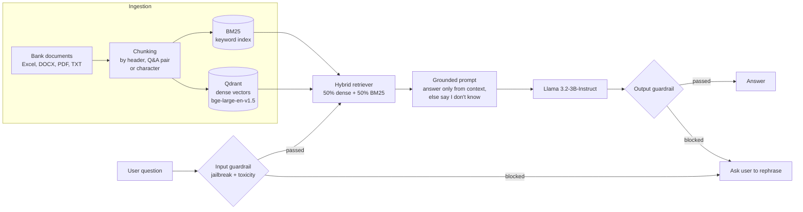
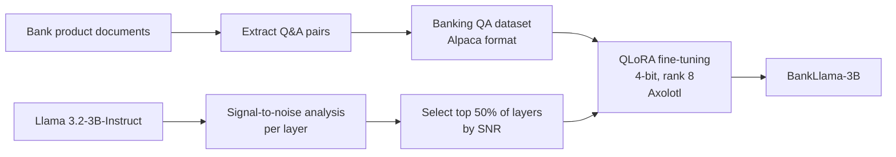

# NUST BankLlama: Banking Assistant with Hybrid RAG and QLoRA Fine-Tuning

A question-answering assistant for NUST Bank's products and services. It combines **hybrid retrieval** (dense vectors + BM25 keyword search) over the bank's own documents with a **Llama 3.2-3B** model, wraps every query and answer in **safety guardrails**, and includes a **QLoRA fine-tuned** variant of the model, *BankLlama-3B*, trained on a banking Q&A dataset built from the same documents.

<p>
  
  
  
  
  
</p>

---

## What it does

A customer types a question such as *"What are the requirements for a personal loan?"*. The assistant:

1. **Checks the question** for jailbreak attempts and toxic language before anything else runs.
2. **Retrieves** the most relevant passages from the bank's product documents using two complementary searches: semantic (meaning) and BM25 (exact terms like product names and fees).
3. **Answers** with Llama 3.2-3B, instructed to use only the retrieved context and to say *"I don't know"* when the answer is not in the documents, rather than inventing one.
4. **Checks the answer** with the same guardrails before showing it.

Staff can also upload new PDF, Word or text documents from the sidebar; they are chunked and added to the knowledge base on the spot.

## How it works



### Why hybrid retrieval?

Banking questions mix **meaning** ("how do I send money abroad?") with **exact terms** ("NUST Asaan Account", fee amounts, form names). Dense embeddings handle the first; BM25 handles the second. The two retrievers are combined with equal weights (LangChain `EnsembleRetriever`), so a passage that matches either way can reach the model.

## Fine-tuning: BankLlama-3B

Alongside the RAG system, the base model was fine-tuned on a banking Q&A dataset (Alpaca format) built from the same documents (`preprocessing/SFT_banking_qa_formatter.py`).



| Setting | Value |
|---|---|
| Base model | `meta-llama/Llama-3.2-3B-Instruct` (a Qwen3-4B config is also included) |
| Method | QLoRA, 4-bit quantisation |
| LoRA rank / alpha / dropout | 8 / 16 / 0.05 |
| Layer selection | Only the 50% of layers with the highest signal-to-noise ratio are adapted |
| Epochs / learning rate | 4 / 2e-5 |
| Batch size | 2 per device, 8 effective (gradient accumulation) |
| Sequence length | 4,000 tokens |
| Training framework | [Axolotl](https://github.com/axolotl-ai-cloud/axolotl) (configs in `sft/axolotl-config/`) |

**Why select layers by signal-to-noise ratio?** Not every layer of a pretrained model benefits equally from fine-tuning. Measuring each layer's signal-to-noise ratio and adapting only the most informative half cuts the number of trained parameters and the training time, while concentrating learning where it matters. The per-layer SNR results are in `sft/snr_results_*`.

Model card and usage: [`sft/README.md`](sft/README.md).

## Repository structure

```
├── app.py                         # Streamlit chat interface with document upload
├── rag_pipeline.py                # Retrieval + prompt + LLM orchestration
├── retriever.py                   # Hybrid retriever (Qdrant dense + BM25)
├── hf_inference_client_embeddings.py  # Embeddings through the Hugging Face Inference API
├── guardrail/                     # Input and output safety checks (Guardrails AI)
├── preprocessing/
│   ├── excel_chunker.py           # Header, Q&A-pair and character chunking
│   ├── SFT_banking_qa_formatter.py  # Builds the fine-tuning dataset
│   └── push_to_huggingface.py     # Publishes the dataset
├── sft/                           # Fine-tuning configs, SNR layer analysis, model card
├── rag/RAG_bank_nust.ipynb        # Exploratory RAG notebook
├── dataset/ , data/               # Source bank documents
└── config.py                      # Models, retrieval and generation settings
```

## Running it

**1. Install**

```bash
git clone https://github.com/AreebAhmad-02/Financial-banking-rag-finetuning.git
cd Financial-banking-rag-finetuning
python -m venv venv && source venv/bin/activate
pip install -r requirements.txt
pip install streamlit langchain-core
```

**2. Configure.** Copy `example.env` to `.env` and fill in:

```env
HUGGINGFACEHUB_API_TOKEN=...   # embeddings + LLM through Hugging Face Inference
QDRANT_HOST=...                # Qdrant Cloud cluster URL
QDRANT_API_KEY=...
QDRANT_COLLECTION_NAME=banking_docs
```

**3. Install the guardrail validators**

```bash
guardrails configure
guardrails hub install hub://guardrails/detect_jailbreak
guardrails hub install hub://guardrails/toxic_language
```

**4. Start the app**

```bash
streamlit run app.py
```

Or use the pipeline directly from Python:

```python
from rag_pipeline import create_rag_pipeline

pipeline = create_rag_pipeline()
pipeline.ingest_documents(json_file="chunks/header/all_chunks.json")
print(pipeline.get_response("What is the NUST Asaan Account?"))
```

## Key settings (`config.py`)

| Setting | Default |
|---|---|
| Embedding model | `BAAI/bge-large-en-v1.5` |
| LLM | `meta-llama/Llama-3.2-3B-Instruct` |
| Documents retrieved per search | 4 |
| Max new tokens / temperature | 512 / 0.7 |

## Author

**Areeb Ahmad Chaudhry**: [website](https://areebahmad-02.github.io) · [Google Scholar](https://scholar.google.com/citations?user=gaDnnFwAAAAJ) · [GitHub](https://github.com/AreebAhmad-02)
